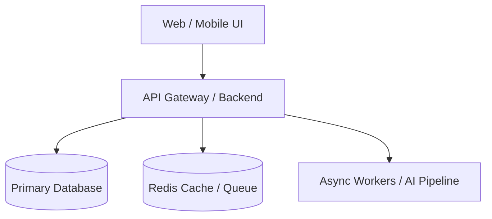

# Standard Project Specification Template

```markdown
# [Project Name]: [Tagline]

## 1. Executive Summary
- **Category / Domain**: [e.g. AI Agents / Developer Ergonomics / B2B SaaS]
- **Target Audience**: [Who is this built for?]
- **Value Proposition**: [What transformation does it deliver in 1-2 sentences?]

## 2. Problem Statement & Market Gap
- **Current Frustration**: [What pain point exists today?]
- **Why Existing Solutions Fall Short**: [Shortcomings of incumbent tools]
- **The Unfair Advantage**: [Why this product architecture wins]

## 3. Core Features Matrix
| Feature | Phase | Description |
|---|---|---|
| Core Feature 1 | MVP (Phase 1) | Core loop functionality |
| Core Feature 2 | MVP (Phase 1) | Data persistence & export |
| Advanced Feature 3 | Phase 2 | Real-time collaboration / Webhooks |
| Enterprise Feature 4 | Phase 3 | SSO, Audit logs, RBAC |

## 4. Technical Architecture

- **Frontend**: [Framework, State Management, UI kit]
- **Backend**: [Language, API architecture, Async runtime]
- **Database & Storage**: [Relational DB, Vector DB, Blob storage]
- **DevOps & Infrastructure**: [Docker, CI/CD, Hosting]

## 5. Key Schemas & API Endpoints
- **Entities**:
  - `Entity 1`: Fields, relationships
  - `Entity 2`: Fields, relationships
- **Core Endpoints**:
  - `POST /api/v1/...`: Description
  - `GET /api/v1/...`: Description

## 6. Hard Engineering Challenges
1. **[Challenge 1]**: [Risk] -> **Solution**: [Mitigation pattern]
2. **[Challenge 2]**: [Risk] -> **Solution**: [Mitigation pattern]

## 7. Antigravity Agent Execution Plan
1. **`code_architect`**: Scaffold module interfaces & design contracts.
2. **`database_architect`**: Create schema migrations and query indexes.
3. **`backend_specialist`**: Implement backend endpoints and business logic.
4. **`frontend_specialist`**: Build responsive views and state integrations.
5. **`qa_test_engineer`**: Implement unit and end-to-end regression suites.
6. **`devops_engineer`**: Containerize service with Docker Compose and CI automation.
```
